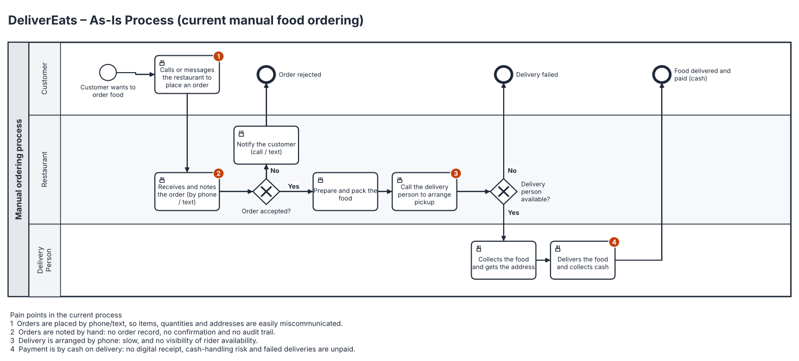
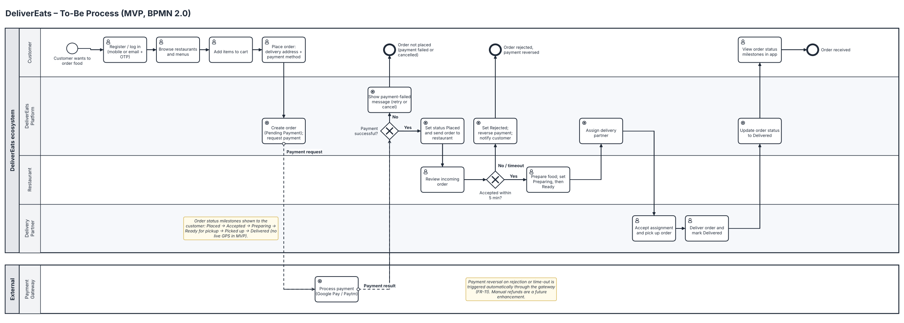
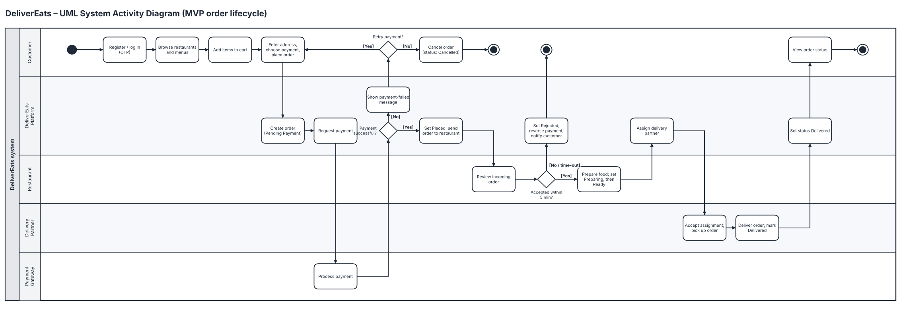
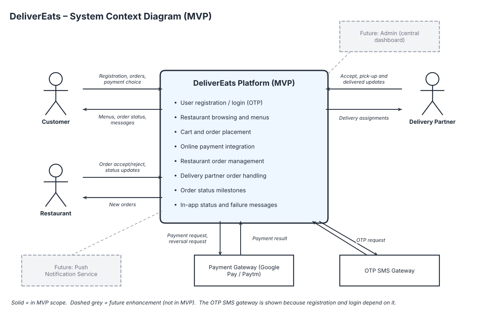
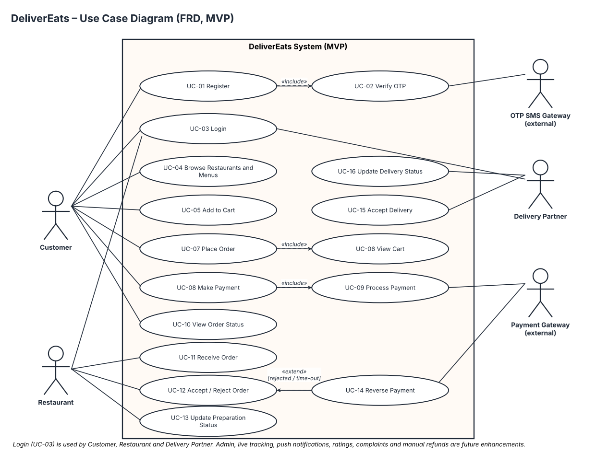

# DeliverEats – Business Analysis Portfolio Project

A food delivery app connecting customers, restaurants and delivery partners. This repository contains the complete Business Analyst deliverables for the project: requirements, process models, system models, wireframes, traceability and test planning.

> **This is a simulated portfolio project.** There are no real stakeholders, sign-offs, source code or executed tests. All approvals in the documents are role placeholders marked as simulated, and all KPI targets are proposals, not measured results.

**Author:** Anandu Priyakumar  |  **Version:** 1.1 (revised 5 November 2026)  |  **Platform:** Android MVP, one city

## MVP scope
**Included:** registration with OTP and login, restaurant browsing and menus, cart, order placement, online payment (Google Pay, Paytm) with automatic reversal on rejection, restaurant order management, delivery partner updates, order status milestones and in-app failure messages.

**Future enhancements (not in MVP):** live GPS tracking, push notifications, central admin dashboard, complaints and manual refunds, ratings, Cash on Delivery. See [`07_future_enhancements`](07_future_enhancements/Future_Enhancements_Backlog.md).

## Key artefacts

### Business process modelling (BPMN 2.0)
| As-Is (manual process, with pain points) | To-Be (MVP) |
|---|---|
| [](02_process_modelling/BPMN_2.0/DeliverEats_As-Is_Process.png) | [](02_process_modelling/BPMN_2.0/DeliverEats_To-Be_Process.png) |

### UML activity diagram
[](02_process_modelling/UML_Activity_Diagrams/DeliverEats_System_Activity_Diagram.png)

### System and use case modelling
| System context | Use cases (FRD) |
|---|---|
| [](03_system_modelling/System_Context_Diagram.png) | [](03_system_modelling/Use_Case_Diagram_FRD.png) |

High-level use cases for the BRD: [`Use_Case_Diagram_BRD.png`](03_system_modelling/Use_Case_Diagram_BRD.png)

### Wireframes
| | |
|---|---|
| [Login and registration](04_wireframes/Login_Registration.png) | [Restaurant list and menu](04_wireframes/Restaurant_List_Menu.png) |
| [Cart and checkout](04_wireframes/Cart_Checkout.png) | [Payment success / failure](04_wireframes/Payment_Screen.png) |
| [Order status milestones](04_wireframes/Order_Status.png) | [Restaurant dashboard](04_wireframes/Restaurant_Dashboard.png) |
| [Delivery partner screens](04_wireframes/Delivery_Partner_Orders.png) | |

### Requirements and testing
- BRD: [PDF](01_requirements/BRD/DeliverEats_BRD_v1.1.pdf) · [Word](01_requirements/BRD/DeliverEats_BRD_v1.1.docx)
- FRD: [PDF](01_requirements/FRD/DeliverEats_FRD_v1.1.pdf) · [Word](01_requirements/FRD/DeliverEats_FRD_v1.1.docx)
- [Functional requirements](05_requirements_analysis/Functional_Requirements.md) · [Non-functional requirements](05_requirements_analysis/Non_Functional_Requirements.md) · [Data requirements](05_requirements_analysis/Data_Requirements.md)
- [Requirements traceability matrix](05_requirements_analysis/Requirements_Traceability_Matrix.md) (also [.xlsx](05_requirements_analysis/Requirements_Traceability_Matrix.xlsx))
- [UAT test cases](06_testing/UAT_Test_Cases.md) – all **Planned (not executed)**; results tracker in [.xlsx](06_testing/UAT_Test_Cases_and_Results.xlsx)

## Repository structure
```
delivereats-business-analysis/
├── README.md
├── 01_requirements/        BRD and FRD (docx + pdf)
├── 02_process_modelling/   BPMN 2.0 As-Is and To-Be, UML activity diagram
├── 03_system_modelling/    System context, BRD and FRD use case diagrams
├── 04_wireframes/          Seven MVP screen groups (PNG)
├── 05_requirements_analysis/ FR, NFR, data requirements, RTM
├── 06_testing/             UAT test cases and results tracker
└── 07_future_enhancements/ Backlog of features excluded from the MVP
```

## What changed in v1.1
- MVP scope aligned: live GPS tracking, push notifications and the admin dashboard moved to future enhancements (FE-01 to FE-03); real-time tracking replaced by order status milestones.
- Availability target aligned at 99.5% per month in both documents (BRD previously 95%).
- Cash on Delivery decision recorded: not supported in the MVP (RULE-08); checkout wireframe updated.
- Payment status and order status separated into two enumerations with an explicit order lifecycle.
- Rejected orders and failed payments defined: automatic payment reversal (FR-11, UC-14) added; complaints, manual refunds and ratings moved to future enhancements.
- UAT scenarios restated as 'Planned (not executed)' and expanded to 10 scenarios with test cases.
- Traceability repaired: every BR maps to FRs, use cases and UAT scenarios; FR-11 no longer shared by unrelated use cases.
- Fictional-celebrity approvers replaced with role-based simulated approvals, clearly labelled as simulated.
- Terminology standardised: real-time, third-party, As-Is, To-Be, Cash on Delivery.
- Added: in-scope delivery partner wireframe, OTP SMS gateway on the context diagram, business-use-case IDs (BUC-xx).

## Skills demonstrated
Business requirements and functional specification, MoSCoW prioritisation, BPMN 2.0 and UML modelling, use case modelling, wireframing, data and non-functional requirements, requirements traceability, UAT planning, scope management and document consistency.
