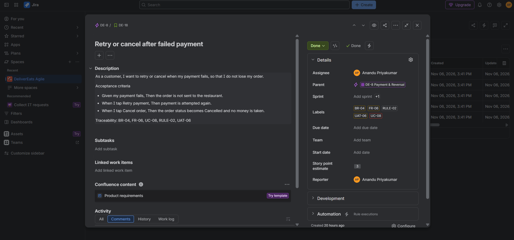

# DeliverEats – Business Analysis Portfolio Project

DeliverEats is a food delivery app connecting customers, restaurants and delivery partners. This repository shows the same Business Analyst project delivered two ways: as traditional **waterfall** documentation and as an **agile** backlog in Jira and Confluence.

> **This is a simulated portfolio project.** There are no real stakeholders, sign-offs, source code or executed tests. Approvals in the documents are role placeholders marked as simulated, KPI targets are proposals, UAT scenarios are planned (not executed), and the Jira sprints are planned (no software was built and no real velocity was measured).

**Author:** Anandu Priyakumar  |  **Waterfall documents:** v1.1 (5 November 2026)  |  **Agile version:** added November 2026  |  **Platform:** Android MVP, one city

## Two versions of the same project

| Folder | Approach | What it contains | Start here |
|---|---|---|---|
| [`waterfall/`](waterfall/) | Document-driven | BRD, FRD, BPMN and UML models, use cases, wireframes, functional, non-functional and data requirements, traceability matrix, UAT test cases, future enhancements | [`waterfall/README.md`](waterfall/README.md) |
| [`agile/`](agile/) | Backlog-driven (Scrum) | 5 epics, 19 user stories with Given/When/Then acceptance criteria, 76 story points, 6 planned sprints, Definition of Ready and Done, decision log, Jira exports and screenshots, Confluence pages | [`agile/README.md`](agile/README.md) |

The agile version re-slices the waterfall requirements and does not add new ones, so both stay consistent. [`agile/traceability_waterfall_to_agile.md`](agile/traceability_waterfall_to_agile.md) maps every business requirement, functional requirement, use case, business rule and UAT scenario to its Jira story.

## MVP scope

**Included:** registration with OTP and login, restaurant browsing and menus, cart, order placement, online payment (Google Pay, Paytm) with automatic reversal on rejection, restaurant order management, delivery partner updates, order status milestones and in-app failure messages.

**Future enhancements (not in MVP):** live GPS tracking, push notifications, central admin dashboard, complaints and manual refunds, ratings, Cash on Delivery (FE-01 to FE-06). See the [future enhancements backlog](waterfall/07_future_enhancements/Future_Enhancements_Backlog.md).

## Quick links

**Waterfall**
- BRD: [PDF](waterfall/01_requirements/BRD/DeliverEats_BRD_v1.1.pdf) · [Word](waterfall/01_requirements/BRD/DeliverEats_BRD_v1.1.docx)
- FRD: [PDF](waterfall/01_requirements/FRD/DeliverEats_FRD_v1.1.pdf) · [Word](waterfall/01_requirements/FRD/DeliverEats_FRD_v1.1.docx)
- [Requirements traceability matrix](waterfall/05_requirements_analysis/Requirements_Traceability_Matrix.md)
- [UAT test cases](waterfall/06_testing/UAT_Test_Cases.md) (all planned, not executed)

**Agile**
- [Sprint plan](agile/sprint_plan.md) · [Definition of Ready and Done](agile/definition_of_done.md) · [Decision log](agile/decision_log.md)
- [Jira backlog export (CSV)](agile/exports/DeliverEats_Backlog_Export.csv) · [Confluence page exports (PDF)](agile/confluence/) · [Jira screenshots](agile/screenshots/)

## Visual highlights

| Waterfall: To-Be process (BPMN 2.0) | Agile: user story in Jira |
|---|---|
| [](waterfall/02_process_modelling/BPMN_2.0/DeliverEats_To-Be_Process.png) | [](agile/screenshots/03_user_story_example.png) |

## How the requirements map between the two versions

| Business requirements | Agile epic | Stories |
|---|---|---|
| BR-01 Register and log in | DE-6 Account & Access | DE-11, DE-12, DE-13 |
| BR-02, BR-03 Browse, cart, place order | DE-7 Ordering | DE-14, DE-15, DE-16 |
| BR-04 Online payment and automatic reversal | DE-8 Payment & Reversal | DE-17, DE-18, DE-19 |
| BR-05, BR-06 Restaurant and delivery handling | DE-9 Restaurant & Delivery Fulfilment | DE-20 to DE-26 |
| BR-07, BR-08 Order status and in-app messages | DE-10 Order Status & Messages | DE-27, DE-28, DE-29 |

Non-functional requirements (NFR-01 to NFR-09) are applied through the agile [Definition of Done](agile/definition_of_done.md). UAT scenarios (UAT-01 to UAT-10) became the acceptance criteria of the stories.

## Repository structure

```
delivereats-business-analysis/
├── README.md                   This overview
├── waterfall/                  Traditional documentation (v1.1)
│   ├── README.md
│   ├── 01_requirements/        BRD and FRD (docx + pdf)
│   ├── 02_process_modelling/   BPMN 2.0 As-Is and To-Be, UML activity diagram
│   ├── 03_system_modelling/    System context, BRD and FRD use case diagrams
│   ├── 04_wireframes/          Seven MVP screen groups (PNG)
│   ├── 05_requirements_analysis/  FR, NFR, data requirements, RTM
│   ├── 06_testing/             UAT test cases and results tracker
│   └── 07_future_enhancements/ Features excluded from the MVP
└── agile/                      Agile version (Jira and Confluence)
    ├── README.md
    ├── sprint_plan.md
    ├── definition_of_done.md
    ├── decision_log.md
    ├── traceability_waterfall_to_agile.md
    ├── exports/                Jira CSV export
    ├── confluence/             Confluence page exports (PDF)
    ├── reports/                Jira dashboard PDFs
    ├── screenshots/            Jira and Confluence screenshots
    └── wireframes/             MVP wireframes used by the stories
```

## Skills demonstrated

- **Requirements and analysis:** business and functional requirements, MoSCoW prioritisation, data and non-functional requirements, scope management, requirements traceability
- **Modelling and design:** BPMN 2.0, UML activity and use case diagrams, wireframing
- **Testing:** UAT planning with traceable scenarios
- **Agile delivery:** epics and user stories, Given/When/Then acceptance criteria, story point estimation, sprint planning, Definition of Ready and Done, decision logging
- **Tools:** Jira (Scrum space, CSV import and export), Confluence (linked documentation), GitHub

## Notes on the simulation

- No application was built. The Jira statuses were set to Done during planning, so the dashboard's cycle time and completion trend are not delivery metrics.
- Cash on Delivery is excluded from the MVP (RULE-08, FE-06) because it conflicts with RULE-02 (payment must succeed before the restaurant sees the order). See the [decision log](agile/decision_log.md).
