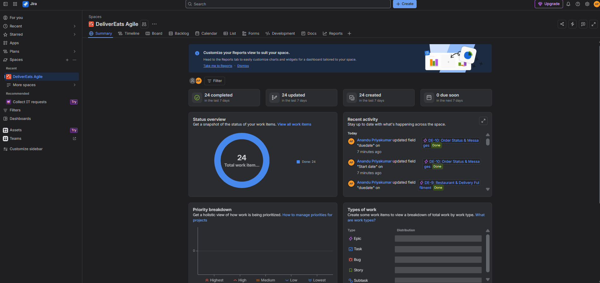
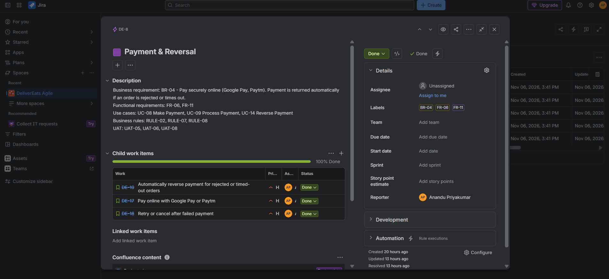
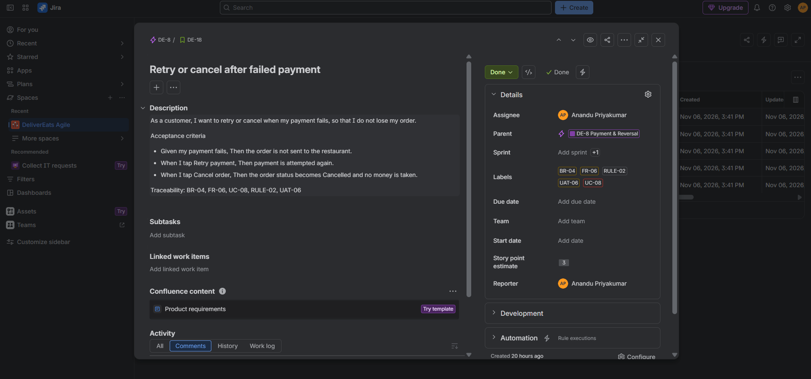
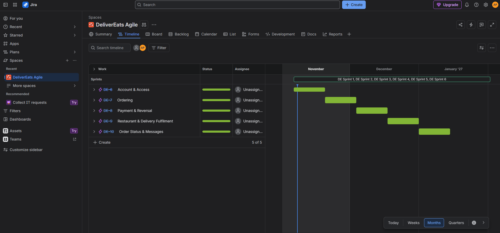
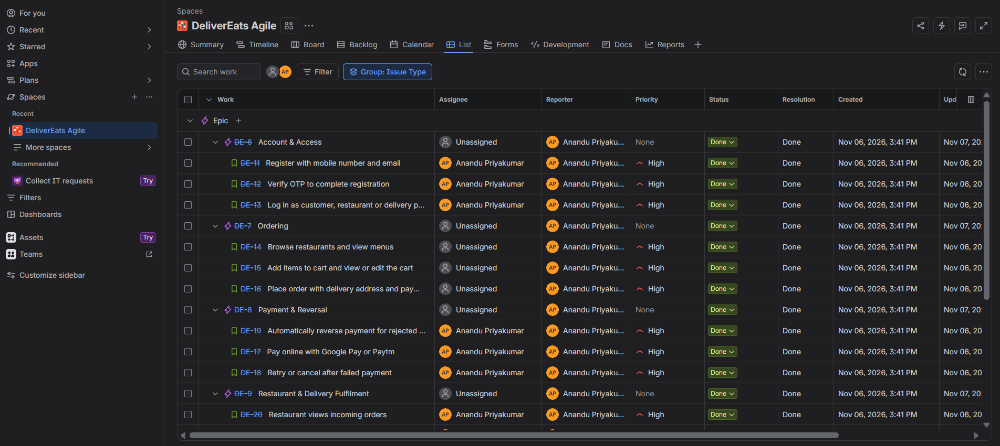
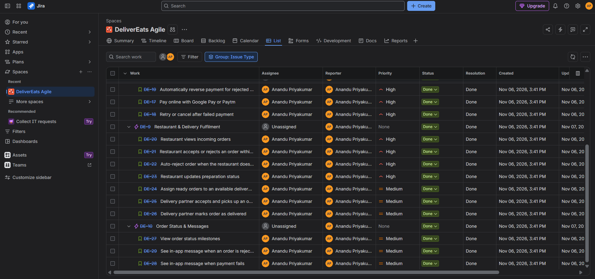
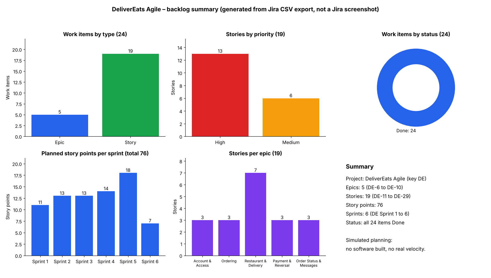
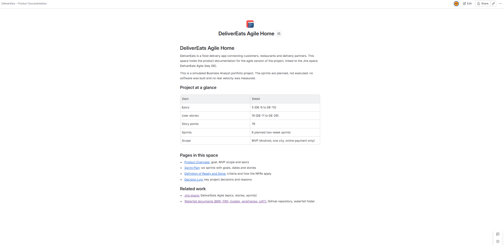
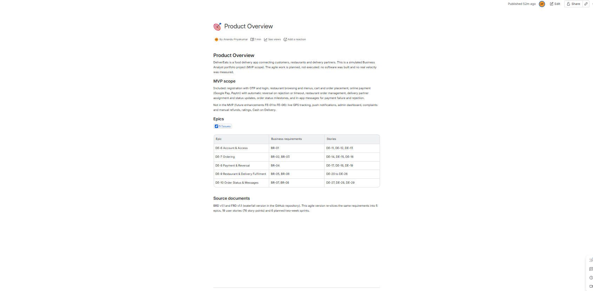
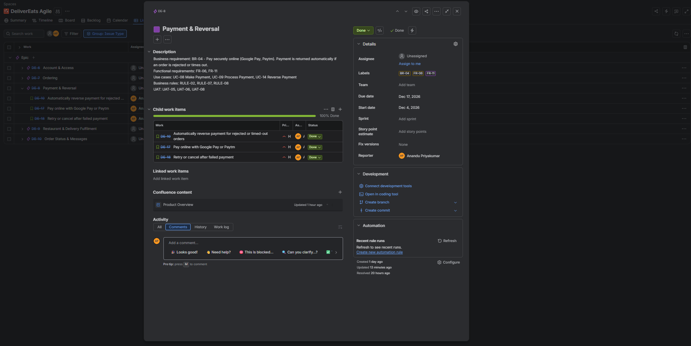

DeliverEats – Agile Version (Jira)
> Simulated Business Analyst portfolio project (DeliverEats v1.1, MVP scope). Not a real production system.
> **All sprints, statuses and charts in this folder are simulated planning. No software was built, no sprint was actually run, and no velocity was measured.**
← Back to repository overview · Waterfall version →
This folder is the agile re-slicing of the waterfall BRD v1.1 and FRD v1.1 in the `waterfall/` folder. The same requirements are organised as epics, user stories, acceptance criteria and six two-week sprints in a Jira Scrum space (DeliverEats Agile, key DE).
At a glance
Item	Count
Epics	5 (DE-6 to DE-10)
User stories	19 (DE-11 to DE-29)
Story points	76
Sprints	6 (two weeks each, planned)
Business requirements covered	8 of 8 (BR-01 to BR-08)
Functional requirements covered	11 of 11 (FR-01 to FR-11)
Use cases covered	16 of 16 (UC-01 to UC-16)
UAT scenarios used as acceptance criteria	10 of 10 (UAT-01 to UAT-10)
Business rules covered	8 of 8 (RULE-01 to RULE-08)
How the waterfall artefacts map to agile
Waterfall artefact	Agile equivalent
BRD business requirements (BR-01 to BR-08)	5 epics (grouped; see the mapping below)
FRD use cases and functional requirements	19 user stories
Business rules (RULE-01 to RULE-08)	Written into story acceptance criteria and labels
UAT scenarios (UAT-01 to UAT-10)	Given/When/Then acceptance criteria on each story
Requirements Traceability Matrix	Labels (BR, FR, UC, RULE, UAT) on every item, plus `traceability_waterfall_to_agile.md`
Non-functional requirements (NFR-01 to NFR-09)	`definition_of_done.md` (not separate stories)
Future enhancements (FE-01 to FE-06)	Recorded in the BRD/FRD; not created in the Jira backlog and not in any sprint
Data requirements	Kept in the waterfall `Data_Requirements.md`; stories reference field rules in their acceptance criteria
Epics
Key	Epic	Business requirements	Stories
DE-6	Account & Access	BR-01	DE-11, DE-12, DE-13
DE-7	Ordering	BR-02, BR-03	DE-14, DE-15, DE-16
DE-8	Payment & Reversal	BR-04	DE-17, DE-18, DE-19
DE-9	Restaurant & Delivery Fulfilment	BR-05, BR-06	DE-20 to DE-26
DE-10	Order Status & Messages	BR-07, BR-08	DE-27, DE-28, DE-29
Five epics were chosen instead of one per BR (see `decision_log.md`). BR-08 (in-app messages) is delivered by DE-28 and DE-29 under the Order Status & Messages epic.
Folder contents
Path	What it is
`sprint_plan.md`	Six sprints with goals, planned dates, stories and points
`definition_of_done.md`	Definition of Done, including how the NFRs are applied
`decision_log.md`	Key decisions and their reasons
`traceability_waterfall_to_agile.md`	BR → epic → story → FR → UC → UAT → RULE
`exports/DeliverEats_Backlog_Export.csv`	Jira export (Excel CSV, all fields): epics, stories, descriptions, labels, points, sprints
`confluence/`	PDF exports of the four Confluence pages (home, product overview, sprint plan, Definition of Ready and Done, decision log)
`reports/`	Jira dashboard PDFs (work item status, type, trends, work item list)
`screenshots/`	Jira screenshots (see below)
`wireframes/`	The seven MVP wireframes (A1 to A7) taken from FRD v1.1, Appendix A
Jira evidence
Screenshot	What it shows
`01_project_overview.png`	Project summary: 24 work items, status overview, recent activity
`02_epic_example.png`	Epic DE-8 Payment & Reversal: description, labels and child stories (100% done)
`03_user_story_example.png`	Story DE-18 with the user story sentence, Given/When/Then criteria, traceability line, parent epic, points and labels
`04_timeline_epics.png`	Epic timeline across DE Sprint 1 to DE Sprint 6
`05_work_items_list_1.png`, `06_work_items_list_2.png`	List view grouped by issue type: all 5 epics with their 19 child stories, priorities and statuses
`07_backlog_summary_charts.png`	Charts generated from the Jira CSV export (not a Jira screenshot): items by type, stories by priority, items by status, points per sprint, stories per epic

Confluence documentation (linked to Jira)
A Confluence space, DeliverEats – Product Documentation, holds four pages that complement the Jira backlog. The Product Overview page embeds a live Jira work item list and links to epics DE-6 to DE-10. The same page is linked back from the epics in Jira. Confluence is private, so the pages are exported to PDF in `confluence/`.
Confluence page	Export
DeliverEats Agile Home	`confluence/00_confluence_home.pdf`
Product Overview	`confluence/01_product_overview.pdf`
Sprint Plan	`confluence/02_sprint_plan.pdf`
Definition of Ready and Done	`confluence/03_definition_of_ready_done.pdf`
Decision Log	`confluence/04_decision_log.pdf`
The PDF exports of tables are narrow and wrap text. The same content is in `sprint_plan.md`, `definition_of_done.md` and `decision_log.md` in a more readable form.
Screenshot	What it shows
`08_confluence_home.png`	Confluence home page with links to the pages and Jira
`09_confluence_page_with_jira_links.png`	Product Overview with the live Jira work item macro and epic table
`10_jira_epic_with_confluence_link.png`	Epic DE-8 in Jira showing the linked Confluence page

Notes on the simulation
All 24 work items were created and moved to Done within one session. The dashboard's cycle and lead time (about 12.5 seconds) and the single-day completion trend reflect that. They are not delivery metrics.
The sprint plan shows how the MVP could be delivered in six sprints (about 12 weeks, matching BRD Objective 1). It is a plan, not a record of execution.
Cash on Delivery is excluded from the MVP (RULE-08, FE-06) and is therefore not in any story.
Source documents
BRD v1.1, FRD v1.1, Requirements Traceability Matrix, UAT Test Cases, Data Requirements, Functional Requirements and Non-Functional Requirements, all in the waterfall folder.
